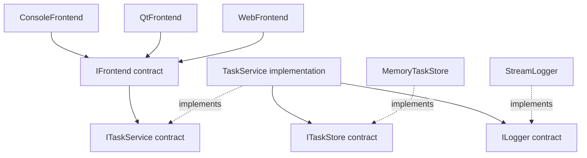

# Interface Lab — 21 practical C++ lessons

**A small, runnable teaching app for a BTech Computer Science student.**

The central idea: **write a caller against a small contract, then change the implementation without rewriting that caller.** StudyDesk, a tiny study-task app, demonstrates this idea through 21 lessons and three real frontends.

This repository uses C++17, ordinary classes, explicit constructors, and short examples. Start with the console lessons. Desktop and web frontends are an optional second step using Qt 6. There are no external services, accounts, databases, or API keys to configure.

## Contents

- [Quick start](#quick-start)
- [What an interface means in C++](#what-an-interface-means-in-c)
- [Architecture](#architecture)
- [The 21 lessons](#the-21-lessons)
- [Lesson walkthroughs and exercises](#lesson-walkthroughs-and-exercises)
- [Real console, desktop and web frontends](#real-console-desktop-and-web-frontends)
- [Build and run on each platform](#build-and-run-on-each-platform)
- [How the runtime plugin works](#how-the-runtime-plugin-works)
- [Learning plan and final challenge](#learning-plan-and-final-challenge)
- [Design rules and tradeoffs](#design-rules-and-tradeoffs)
- [Tests, troubleshooting and verification](#tests-troubleshooting-and-verification)
- [Repository map and Git workflow](#repository-map-and-git-workflow)
- [References](#references)

## Quick start

Install **CMake 3.20+** and a **C++17 compiler** first. Suggested toolchains: GCC 10+, Apple Clang from a recent Xcode Command Line Tools installation, or Visual Studio 2022 with the **Desktop development with C++** workload. Git is useful for the exercises, but not required to build an extracted source tree.

Run these commands **from the repository root**:

### Windows PowerShell

```powershell
.\scripts\build-windows.ps1
.\build\bin\interface_lab.exe --list
.\build\bin\interface_lab.exe --example 3
.\build\bin\interface_lab.exe --all
.\build\bin\interface_lab.exe --cui
```

### Linux

```bash
bash scripts/build-linux.sh
./build/bin/interface_lab --list
./build/bin/interface_lab --example 3
./build/bin/interface_lab --all
./build/bin/interface_lab --cui
```

### macOS

```bash
bash scripts/build-macos.sh
./build/bin/interface_lab --list
./build/bin/interface_lab --example 3
./build/bin/interface_lab --all
./build/bin/interface_lab --cui
```

The build scripts configure, compile, and run CTest. The ordinary build has **24 tests**: all 21 lessons, the shared-service contract test, and two invalid-input/loading checks. A successful build ends with `100% tests passed`.

Run `--help` for all options. Examples write only their dedicated demonstration files under `lab-output/` in the current directory. Lesson 3 replaces `03-session.log`; lesson 6 resets `06-tasks.txt` so repeated demonstrations stay predictable. Use `--output another-directory` to change that location. The interactive task app keeps its tasks in memory.

## What an interface means in C++

An interface is a contract describing an operation that callers may use. A charger socket is a useful analogy: a compatible device depends on the socket's specification, not the internal wiring of every charger.

C++ has no `interface` keyword. This course expresses runtime interfaces using **pure abstract base classes**:

```cpp
struct ILogger {
    virtual ~ILogger() = default;
    virtual void log(const std::string& message) = 0;
};
```

| Syntax | Meaning |
|---|---|
| `struct` | Members are public by default; a `class` with `public:` works too. |
| `virtual` | Calls through a base reference or pointer dispatch to the concrete implementation. |
| `= 0` | Pure virtual function: a concrete derived class must implement it. |
| `virtual ~ILogger()` | Allows safe destruction through an interface pointer. |
| `override` | Asks the compiler to verify that an implementation matches a base virtual function. |
| `ILogger&` | A borrowed reference to any compatible logger; it does not own the object. |
| `std::unique_ptr<ILogger>` | An owning pointer with automatic destruction. |

For example, the client below has no knowledge of files, terminals, or memory buffers:

```cpp
void startSession(ILogger& logger) {
    logger.log("Study session started");
}
```

A file logger and a console logger implement that same contract. Choosing a concrete implementation is done at the **composition root**: the place where the program constructs and connects its objects, usually `main()`.

**Before interfaces:** a client constructs `FileLogger` internally, so changing its destination requires editing the client.

**After interfaces:** the caller supplies `ILogger&`, so the same client can use `FileLogger`, `StreamLogger`, or a recording test double.

The concrete dependency still exists somewhere. We have moved the choice to a clear boundary; we have not magically removed it.

A C++ type matching the function signature is only half the contract. Units, valid input, errors, side effects, and object lifetimes matter too. A temperature sensor promising Celsius must return Celsius in every implementation.

## Architecture

The runnable app's core is in [core.hpp](include/studydesk/core.hpp) and [core.cpp](src/core.cpp).



All three frontends implement `IFrontend::run(ITaskService&)`. They all call `ITaskService::addTask()` and `tasks()`. `TaskService` owns the validation rule and uses injected storage and logging interfaces.

The frontends are separate executables or modes using the **same core source/library and contracts**. They are not connected to a shared server or a shared live database. Each process has its own in-memory task list. Closing it clears that list.

Lessons 1–21 are small experiments inside one `interface_lab` executable. Some reuse the StudyDesk core; others keep a separate tiny scenario in one file to make one concept easy to read. This is intentionally not a large framework with 21 interconnected services.

## The 21 lessons

The first five address the requested themes. Lessons 6–21 add sixteen different practical uses.

| # | Practical example | Main interface | Main lesson |
|---|---|---|---|
| 01 | Runtime plugin / add-in | `IStudyPlugin` | Load an implementation from a separate library. |
| 02 | Add new app features | `IFeature` | Extend the app without editing its feature runner. |
| 03 | Console, file and memory logging | `ILogger` | Replace an infrastructure dependency. |
| 04 | Console, desktop GUI and web app | `IFrontend`, `ITaskService` | Share business logic across presentation technologies. |
| 05 | Revision planning | `IRevisionStrategy` | Strategy pattern: replace an algorithm. |
| 06 | Memory and file storage | `ITaskStore` | Repository boundary: separate storage from rules. |
| 07 | Notification channels | `INotifier` | Swap delivery providers. |
| 08 | Workshop payment simulation | `IPaymentGateway` | Isolate a provider and handle declined results. |
| 09 | Plain text and CSV export | `ITaskExporter` | Separate data from its representation. |
| 10 | Temperature sensors | `ITemperatureSensor` | Hide device details and normalize units. |
| 11 | Deadline checks | `IClock` | Make time-dependent behavior deterministic. |
| 12 | Printer and scanner capabilities | `IPrinter`, `IScanner` | Small interfaces and multiple interface inheritance. |
| 13 | Task completion listeners | `ITaskObserver` | Observer pattern: add independent reactions. |
| 14 | Logging prefixes | `ILogger` | Decorator pattern: compose extra behavior. |
| 15 | Legacy attendance API | `IAttendance` | Adapter pattern: translate an existing API. |
| 16 | Brief and detailed reports | `IReport` | Simple Factory: centralize implementation selection. |
| 17 | Rename and undo | `ICommand` | Command pattern: represent an action as an object. |
| 18 | Draft and submitted assignments | `ISubmissionState` | State pattern: vary behavior with state. |
| 19 | Required and length rules | `IValidationRule` | Compose a validation pipeline. |
| 20 | Cached course lookup | `ICourseCatalog` | Proxy pattern: mediate access and caching. |
| 21 | Storage failure and log recording | `ITaskStore`, `ILogger` | Test doubles: reproduce failures and inspect interactions. |

## Lesson walkthroughs and exercises

For each lesson: **predict the output, run it, read the interface, find the caller, then change one implementation**. On Windows, use `interface_lab.exe`; elsewhere, use `interface_lab`.

### 01 — Runtime plugin / add-in

**Read:** [01_plugins.cpp](examples/01_plugins.cpp), [plugin.hpp](include/studydesk/plugin.hpp), [pomodoro.cpp](plugins/pomodoro.cpp).

**Problem:** the host should use an add-in compiled into a separate library. `SharedLibrary` loads the module; exported functions check its version, create the object and destroy it. Calls then go through `IStudyPlugin`. The two-session check produces 50 minutes.

**What stays unchanged:** the host does not include or instantiate `PomodoroPlugin`.

**Try:** change the plugin's session duration to 30 minutes, rebuild only the plugin, and run lesson 1 again. The existing 50-minute check should fail: you changed behavior without rebuilding the host. Update the lesson's expectation only after understanding why it failed. To add a second plugin, follow the detailed plugin exercise below.

### 02 — New functionality in the base app

**Read:** [02_new_features.cpp](examples/02_new_features.cpp).

`StudyApp` stores `unique_ptr<IFeature>` objects. `Timetable` and `ExamCountdown` implement the same operation. The app loops over the installed features without a growing list of type checks.

**Try:** add `AssignmentReminder`, implement `execute()`, and register it in `run()`. Do not edit `StudyApp::run()`. This is extension through source code and a rebuild; lesson 1 shows runtime loading instead.

### 03 — Multiple loggers

**Read:** [03_loggers.cpp](examples/03_loggers.cpp).

The identical `startSession(ILogger&)` call sends one event to a console, a real file, and a memory vector. The file output and recorded memory event are compared.

**Try:** add `NullLogger` that intentionally discards events. Then add an error-stream logger by constructing `StreamLogger` with `std::cerr`. Does the client need another `if` statement?

### 04 — CUI, GUI and web app

**Read:** [04_frontends.cpp](examples/04_frontends.cpp), [core.cpp](src/core.cpp), [gui.cpp](frontends/gui.cpp), [web.cpp](frontends/web.cpp).

The lesson runs the console frontend using a scripted input stream. For real interaction, use `--cui`, `studydesk_gui`, or `studydesk_web`. The latter two are actual Qt frontends, not printed mockups.

**Try:** change the 80-byte limit in `TaskService::addTask()`. Rebuild and confirm that all three frontends apply it. Update the UI hints and relevant tests too; display text is separate from the validation rule.

### 05 — Strategy pattern

**Read:** [05_strategy.cpp](examples/05_strategy.cpp).

The revision planner receives a strategy. Three chapters take 90 minutes with `RegularRevision` and 30 with `QuickRevision`. The planner does not inspect the concrete type.

**Try:** add a 45-minute `DeepRevision`. Keep `planMinutes()` unchanged. Later compare this class interface with passing a function or lambda for such a small algorithm.

### 06 — Repository / storage boundary

**Read:** [06_repositories.cpp](examples/06_repositories.cpp).

The same `TaskService` works with `MemoryTaskStore` and `TextTaskStore`. Reopening the text store demonstrates real persistence. One title is stored per line. This is a small repository example, not a database engine.

**Try:** create a `CountingTaskStore` wrapper that forwards calls and counts reads. Pass it to the service without changing `TaskService`.

### 07 — Notification channels

**Read:** [07_notifications.cpp](examples/07_notifications.cpp).

`remind()` depends on `INotifier`. Email and desktop implementations produce local previews. No email, SMS, or desktop notification is actually sent.

**Try:** add `SmsPreview`. Keep the reminder's wording in the caller so all channels receive the same message.

### 08 — Payment gateway boundary

**Read:** [08_payments.cpp](examples/08_payments.cpp).

A fictional Rs 500 workshop purchase receives an approved or declined result through `IPaymentGateway`. Amounts are integer paise. There are no real payments or reservations.

**Try:** add a gateway that declines amounts above Rs 300. Verify that the workshop flow takes the failure path without any payment-provider-specific logic.

### 09 — Export formats

**Read:** [09_export_formats.cpp](examples/09_export_formats.cpp).

`ITaskExporter` turns the same task data into plain text or CSV. The CSV example includes a comma and quotes so that format escaping is visible and checked.

**Try:** implement `HtmlTaskExporter` and escape `&`, `<`, `>`, and quotes. Keep `exportTasks()` unchanged. CSV escaping is not spreadsheet-formula sanitization; this lesson only demonstrates local serialization.

### 10 — Hardware abstraction

**Read:** [10_sensors.cpp](examples/10_sensors.cpp).

A cooling rule depends on Celsius, regardless of whether the simulated device reports Celsius or Fahrenheit. The conversion belongs in the device implementation.

**Try:** add a sensor returning 20°C and verify that cooling is not requested. Discuss why returning 86 as if it were Celsius violates the contract despite compiling successfully.

### 11 — Injecting time

**Read:** [11_clocks.cpp](examples/11_clocks.cpp).

`SystemClock` can read the real wall clock. `FixedClock` lets the deadline rule be checked just before, exactly at, and just after a deadline without sleeping. The rule explicitly says overdue means **strictly later** than the deadline.

**Try:** change the business rule to include the exact deadline. Update the boundary check deliberately. Use a monotonic clock for elapsed durations in a different application.

### 12 — Small interfaces and multiple inheritance

**Read:** [12_small_interfaces.cpp](examples/12_small_interfaces.cpp).

`SimplePrinter` implements only `IPrinter`; `AllInOne` implements both `IPrinter` and `IScanner`. The printing client requests only the capability it needs. This avoids a `scan()` operation that a simple printer cannot honestly support.

**Try:** add `ICopier` and implement it on the multifunction device. Keep the print-only client unchanged.

### 13 — Observer pattern

**Read:** [13_observer.cpp](examples/13_observer.cpp).

One completion event updates a progress counter and an activity feed. The publisher knows only `ITaskObserver`. Delivery is synchronous and listeners are borrowed; they must outlive the publisher. No listener-list changes are supported during a callback.

**Try:** add a badge listener that responds after three completions. Do not edit `TaskEvents::completed()`.

### 14 — Decorator pattern

**Read:** [14_decorator.cpp](examples/14_decorator.cpp).

`PrefixLogger` is an `ILogger` and wraps another `ILogger`. Two wrappers add course and student prefixes before forwarding to a stream logger.

**Try:** reverse the wrapper order and predict the output. Add a decorator that counts messages while forwarding them.

### 15 — Adapter pattern

**Read:** [15_adapter.cpp](examples/15_adapter.cpp).

The legacy attendance API returns basis points. Its adapter implements `IAttendance` and converts 8250 into 82.5 percent. The policy client sees the normalized interface. The 75% threshold is fictional teaching data, not an NSUT rule.

**Try:** adapt a second API that returns a fraction such as `0.825`. Keep the policy client unchanged.

### 16 — Simple Factory

**Read:** [16_factory.cpp](examples/16_factory.cpp).

A configuration string selects a brief or detailed report; callers own `unique_ptr<IReport>`. An unknown configuration is rejected. The type-selection `if` statements live in the factory.

**Try:** add a third report and update the factory. Notice that a factory may change when a type is added while report-consuming code stays stable. This is a **Simple Factory**, not the distinct GoF Factory Method pattern.

### 17 — Command and undo

**Read:** [17_undo_commands.cpp](examples/17_undo_commands.cpp).

`RenameTask` stores the prior title. A generic `ICommand` caller executes and undoes it. This small command rejects double execution until it has been undone.

**Try:** add a command that changes a priority value, then create a history holding `unique_ptr<ICommand>`. The objects modified by commands must outlive their history entries.

### 18 — State pattern

**Read:** [18_state.cpp](examples/18_state.cpp).

An assignment delegates editing permission to `ISubmissionState`. A draft is editable; a submitted assignment is not. The simple transition is explicit in `submit()`.

**Try:** add a `ReturnedForRevision` state and a transition into it. With only two trivial states an enum would also be reasonable; state objects become more useful as state-specific behavior grows.

### 19 — Validation pipeline

**Read:** [19_validation_pipeline.cpp](examples/19_validation_pipeline.cpp).

A runner evaluates independent `IValidationRule` objects and returns the first error. Required text and a **20-byte lesson-specific limit** demonstrate composition; this is intentionally separate from the core app's 80-byte rule.

**Try:** add a rule rejecting a reserved title, and change rule order to see which error is reported first. Then modify the runner to collect all errors.

### 20 — Caching proxy

**Read:** [20_cache_proxy.cpp](examples/20_cache_proxy.cpp).

`CachedCatalog` implements the same `ICourseCatalog` as the simulated remote source. The second lookup avoids another source call; clearing the cache permits a fresh fetch. The simulated source makes no network requests.

**Try:** cache a second course and count source calls. Discuss invalidation and stale data before adding a time-to-live policy, potentially using `IClock`.

### 21 — Test doubles and failure paths

**Read:** [21_test_doubles.cpp](examples/21_test_doubles.cpp).

An `UnavailableStore` deliberately fails while a `RecordingLogger` captures events. The unchanged service propagates the storage failure and does not emit a successful-add log. A normal memory store then confirms the success path.

**Try:** make a store fail on its second write. Verify that the first task remains and only successful writes are logged. Then ask what happens if storage succeeds but logging fails: the small service does not provide a transaction across both operations.

## Real console, desktop and web frontends

### Console / CUI

```text
StudyDesk CUI | add <title>, list, quit
> add Revise interfaces
[log] Added: Revise interfaces
Added.
> list
- Revise interfaces
> quit
```

Blank titles, titles over 80 UTF-8 bytes, and control characters are rejected by the service. The limit is bytes, not Unicode character count. This choice keeps the core independent of a text-processing library.

### Desktop GUI

Build with Qt enabled, then run `studydesk_gui`. The window has a text field, Add button, list and status message. Click Add or press Enter. The GUI calls `ITaskService`; it does not duplicate storage or validation logic.

### Web app

Build with Qt enabled, then run `studydesk_web`. Open **http://127.0.0.1:8080/** in a browser on the same computer. The browser sends a form POST to the C++ server; the server calls the same service and returns a page showing its tasks.

```bash
./build-qt/bin/studydesk_web        # port 8080
./build-qt/bin/studydesk_web 8090   # choose another port
```

On Windows, use `.\build-qt\bin\studydesk_web.exe`. Stop the server with Ctrl+C. The server binds only to IPv4 loopback. It is an in-memory, local teaching application without authentication or public-server hardening. Do not use it as a public hosted application. A desktop app and web process do not automatically share data merely because they share an interface.

## Build and run on each platform

### Common manual CMake commands

These are equivalent to the core build scripts:

```bash
cmake -S . -B build -DCMAKE_BUILD_TYPE=Debug
cmake --build build --config Debug --parallel 2
ctest --test-dir build -C Debug --output-on-failure
```

`--config Debug` supports multi-configuration generators such as Visual Studio. Executables and the plugin are always under `build/bin/`. Use a fresh build directory when switching compiler, architecture, or CMake generator. Use `build-qt/` for the optional frontend build.

### Windows setup

1. Install Visual Studio 2022 or its Build Tools with **Desktop development with C++**, the MSVC compiler and a Windows SDK.
2. Install CMake 3.20+ and make it available on `PATH`. Open a Developer PowerShell for Visual Studio.
3. Run the Windows quick-start commands. If PowerShell blocks scripts, use the manual CMake commands above under your normal script policy.

For the GUI and web app, install a Qt 6.4+ desktop kit matching your compiler and architecture. Include **Qt HTTP Server** and **Qt WebSockets** in addition to the base libraries containing Widgets and Network. For example, an MSVC 2022 64-bit kit belongs with the MSVC 2022 x64 compiler; do not mix it with a MinGW kit.

```powershell
# Replace this example path with your actual Qt installation.
$QtPrefix = "C:\Qt\6.8.3\msvc2022_64"
.\scripts\build-windows.ps1 -WithQt -QtPrefix $QtPrefix
# The DLL path is needed when launching these programs from this shell.
$env:PATH = "$QtPrefix\bin;" + $env:PATH
.\build-qt\bin\studydesk_gui.exe
.\build-qt\bin\studydesk_web.exe
```

Python 3 is optional and enables the HTTP integration test. The app itself remains C++ and does not require Python. The Qt build script adds the kit's `bin` directory for its build/test invocation; set it in a new shell before launching the frontends there.

### Linux setup

For Ubuntu 24.04 or a compatible Debian-based environment, the ordinary prerequisites are:

```bash
sudo apt update
sudo apt install build-essential cmake
bash scripts/build-linux.sh
```

Optional Qt development packages and the HTTP test interpreter:

```bash
sudo apt install qt6-base-dev qt6-httpserver-dev qt6-websockets-dev python3
bash scripts/build-linux.sh --qt
./build-qt/bin/studydesk_gui
./build-qt/bin/studydesk_web
```

Other distributions use different package names. A Qt SDK installation is also supported:

```bash
bash scripts/build-linux.sh --qt -DCMAKE_PREFIX_PATH=/path/to/Qt/6.8.3/gcc_64
```

### macOS setup

Install Apple's compiler tools and CMake. If Homebrew is already available:

```bash
xcode-select --install
brew install cmake
bash scripts/build-macos.sh
```

For the GUI and web app, install Qt 6 including HTTP Server. With a Homebrew Qt installation containing that module:

```bash
brew install qt
bash scripts/build-macos.sh --qt -DCMAKE_PREFIX_PATH="$(brew --prefix qt)"
./build-qt/bin/studydesk_gui
./build-qt/bin/studydesk_web
```

If CMake cannot find HTTP Server in that installation, use a Qt desktop SDK kit with the **Qt HTTP Server** and **Qt WebSockets** modules selected and pass its actual kit directory using `CMAKE_PREFIX_PATH`. Apple Silicon and Intel builds must use matching compiler, Qt kit and plugin architectures.

### Qt dependency choice

The C++ standard library does not provide native desktop widgets or an HTTP server. Qt provides those parts so the frontend examples can focus on interfaces. Qt is **not downloaded automatically** by the project. The ordinary 21-lesson build does not need it.

The project accepts Qt 6.4+ and accommodates the changed `QAbstractHttpServer::bind()` return type from Qt 6.8 onward. Use a Qt release supported by your installed compiler. Qt is an external dependency with its own licensing terms; no Qt binaries are included in this source package.

## How the runtime plugin works

1. CMake builds `pomodoro_plugin` as a separate loadable module.
2. The executable finds it beside the executable when launched with the documented relative or absolute path.
3. `LoadLibraryW` on Windows or `dlopen` on Linux/macOS loads the code.
4. The host resolves version, create and destroy functions, then checks contract version 1.
5. The host owns an `IStudyPlugin` through a `unique_ptr` with a plugin-supplied deleter.
6. The object is destroyed before its module is unloaded.

The exported factory names use C linkage, but the object interface is still C++. **This is not a stable cross-compiler ABI.** Host and plugin must be built with the same compatible toolchain, runtime, architecture, build configuration and contract headers. The version check is a simple teaching check, not proof of binary compatibility. A stable cross-language or cross-compiler plugin API generally needs a carefully designed C ABI or another explicit boundary.

The source package builds trusted example code. Loading a plugin runs native code with the host's permissions. Use only plugins you build and trust.

To locate a plugin explicitly:

```bash
./build/bin/interface_lab --example 1 --plugin ./build/bin/pomodoro_plugin.so
```

Windows normally produces `pomodoro_plugin.dll`. macOS CMake `MODULE` targets normally produce `pomodoro_plugin.so`; use the actual generated filename. The default filename is injected by CMake, so ordinary runs do not need an extension assumption. When launching `interface_lab` by a bare name from `PATH`, supply `--plugin` explicitly because this simple loader uses `argv[0]` to locate the executable directory.

To add a second plugin:

1. Copy `plugins/pomodoro.cpp` to `plugins/deep_work.cpp`.
2. Implement `IStudyPlugin`; keep the three exported entry-point names.
3. Add a second `MODULE` target, its `include` directory, and `PREFIX ""` to CMake.
4. Build and pass the new module's path using `--plugin`.
5. Initially preserve the two-session result of 50 to pass the existing behavior check, while changing `name()`. Then deliberately change the behavior and adapt the expected result as a separate exercise.

## Learning plan and final challenge

| Session | Read/run | Question to answer |
|---|---|---|
| 1 | Primer, lessons 3 and 5 | Which line calls the interface, and which class handles the call? |
| 2 | Lessons 2, 6, 7, 8, 9, 10 | What changes when I add another implementation? |
| 3 | Lessons 11, 12 and 21 | How do small contracts make difficult tests possible? |
| 4 | Lessons 13–20 | How do several design patterns use the same interface mechanism differently? |
| 5 | Lesson 1 and all three frontends | Which boundaries allow separately developed parts to cooperate? |

**Final challenge:** add a task-completion feature to all three frontends. First extend the service contract and its implementation; then update each adapter and the tests. This shows the other side of the lesson: changing a shared contract can require changes in several clients. Stable interfaces should represent a coherent responsibility, not predict every imaginable future feature.

Then add a new logging implementation without editing the task service. Compare the number and type of changes in these two exercises.

A useful self-check after every lesson:

1. Can I point to the contract, concrete implementations and caller?
2. Can I explain why this contract exists?
3. Can I add an implementation without modifying the caller?
4. Can I test the caller without the real device, clock, file or provider?
5. Would a normal function or concrete class be simpler for this particular problem?

## Design rules and tradeoffs

- **Depend on a small capability.** `IPrinter` does not force every printer to scan.
- **Inject dependencies through constructors or parameters.** No global service locator or dependency-injection framework is needed.
- **Keep ownership visible.** References borrow objects. `unique_ptr` owns them. Borrowed objects must outlive their clients.
- **Use `override` and virtual destructors.** Let the compiler check implementation signatures and make polymorphic destruction safe.
- **Do not copy polymorphic objects by value.** Use references or owning pointers to avoid slicing. No `dynamic_cast` is needed here.
- **Separate domain logic from UI code.** Core headers do not include Qt headers.
- **Honor behavior, not only syntax.** Substitutable implementations must respect units, errors and promised results.
- **Keep selection logic at the boundary.** Factories and `main()` may know concrete types; business logic usually should not need to.

The examples illustrate Dependency Inversion, Open/Closed, Interface Segregation and behavioral substitution. These are design tools, not a requirement to give every class an `I`-prefixed partner. The `I` prefix is a teaching convention, not a C++ language rule.

For a single stable implementation, a normal class or function is often enough. For compile-time generic code, templates and C++20 concepts are alternatives. This C++17 course focuses on runtime substitution; a pure virtual class is not the only kind of interface in software.

Virtual calls add indirection and interface boundaries add types to understand. None of that is automatically expensive enough to matter here, but neither is abstraction free. Use an interface for a meaningful variation point, test seam or boundary.

### Scope kept deliberately small

- All data is fictional and local. Notifications, payments, hardware and remote catalogs are simulations.
- The desktop, console and web apps have an in-memory store per process. Lesson 6 alone demonstrates a small text-file store.
- There is no threading, authentication, database transaction management, retry framework, production deployment or distributed synchronization.
- Observer lifetimes, command history, plugin ABI evolution, text storage and caching are intentionally limited and explained where introduced.
- A logger throwing after a successful write can leave a saved task even though the caller sees an exception. The example service does not claim atomicity across storage and logging.

## Tests, troubleshooting and verification

```bash
ctest --test-dir build -C Debug --output-on-failure
ctest --test-dir build -C Debug -R '^lesson_3$' --output-on-failure
ctest --test-dir build-qt -C Debug --output-on-failure
```

Qt builds add a GUI smoke test that clicks the actual Add button and checks validation. If Python 3 is available, an HTTP test starts the actual C++ server, adds a task, checks HTML escaping and rejects invalid input. The GUI test uses Qt's offscreen backend; normal GUI use opens a real window.

Checks throw on failure instead of using `assert`, so they remain active in Release builds. CTest isolates demonstration output by lesson. Tests demonstrate observable behavior, including plugin errors, deadline boundaries and provider failures.

**Validation performed for this package (10 October 2026):**

| Environment/check | Observed result |
|---|---|
| Linux, GCC 13.3, C++17, Debug core build | All 24 tests passed. |
| Linux, GCC 13.3, Release core build with warnings treated as errors | Compiled successfully; all 24 tests passed. |
| Linux, Qt 6.8.3, complete Debug build | All 26 tests passed, including actual offscreen widget interaction and real local HTTP requests. |
| Windows and macOS | Build scripts and CI jobs are included; native runs were not performed in this authoring environment. |

Cross-platform CI is configured in [.github/workflows/build.yml](.github/workflows/build.yml). A workflow file is not evidence that its remote jobs have already run. The Qt tests validate behavior; the GUI has not been visually reviewed on every desktop platform.

| Symptom | Action |
|---|---|
| `cmake` is not recognized | Install CMake, add it to `PATH`, then open a new terminal. |
| C++ compiler not found on Windows | Install the C++ workload and use Developer PowerShell. |
| Qt or `Qt6HttpServer` not found | Install the matching Qt modules and pass the kit directory as `CMAKE_PREFIX_PATH`. |
| Qt DLL missing on Windows | Add the chosen Qt kit's `bin` directory to `PATH` before launching. |
| Plugin cannot load | Build the whole project and use the matching plugin beside the executable; supply `--plugin` explicitly if needed. |
| Plugin version or symbols differ | Rebuild host and plugin from the same headers/toolchain. |
| Port 8080 is busy | Run `studydesk_web 8090` and open port 8090 instead. |
| GUI has no display in Linux CI | Use `QT_QPA_PLATFORM=offscreen` for the smoke test; normal desktop use needs a display. |
| Changed compiler but CMake uses the old one | Configure a new build directory. |
| Script executable bit was lost during ZIP extraction | Run shell scripts with `bash`, as shown in quick start. |

## Repository map and Git workflow

| Path | Purpose |
|---|---|
| `README.md` | All setup steps, architecture, lessons, exercises and limitations. |
| `CMakeLists.txt` | Build targets and tests. |
| `include/studydesk/` | Shared service, plugin and lesson contracts. |
| `src/` | Core implementation, CLI and explicit lesson registry. |
| `examples/01_*.cpp` … `21_*.cpp` | One readable lesson per source file. |
| `plugins/` | Separately compiled runtime add-in. |
| `frontends/` | Real Qt desktop and HTTP frontend implementations. |
| `tests/` | Core contract checks and HTTP integration checks. |
| `scripts/` | Windows, Linux and macOS build scripts. |
| `.github/workflows/build.yml` | Automated cross-platform build/test configuration. |
| `.clang-format`, `.editorconfig` | Consistent code layout and editor settings. |
| `LICENSE` | MIT license for this repository's original code. |

The ZIP contains a source working tree and **`interface-lab.bundle`**, a portable Git bundle with its initial committed history. It excludes build output and platform binaries. To obtain a real Git checkout, extract the ZIP and run, from its top-level folder:

```bash
git clone interface-lab.bundle my-interface-lab
cd my-interface-lab
git switch -c exercise/new-logger
```

Alternatively, build the `interface-lab/` source folder directly, or initialize it with `git init`. The bundle clone creates a local remote pointing at the bundle; it is not a hosted repository. To publish to a repository you create on GitHub or another Git service:

```bash
git remote remove origin
git remote add origin <your-new-empty-repository-url>
git push -u origin main
```

Replace the placeholder with your own URL. No hosted repository or public deployment is created by this package. After changing code, build and run the tests, then commit the exercise using your own Git identity.

## References

Primary references used to check the design and build setup:

- [C++ Core Guidelines](https://isocpp.github.io/CppCoreGuidelines/CppCoreGuidelines): interface classes, virtual destructors, ownership, and ABI boundaries, especially C.121, C.35 and I.26.
- [CMake tutorial](https://cmake.org/cmake/help/latest/guide/tutorial/index.html) and [runtime output directories](https://cmake.org/cmake/help/latest/prop_tgt/RUNTIME_OUTPUT_DIRECTORY.html).
- [Qt Widgets](https://doc.qt.io/qt-6/qtwidgets-index.html), [Qt HTTP Server](https://doc.qt.io/qt-6/qthttpserver-index.html), and [Qt CMake getting started](https://doc.qt.io/qt-6/cmake-get-started.html).

The examples and explanations are original teaching material, not a claim to implement a production framework or any university's official policies.
